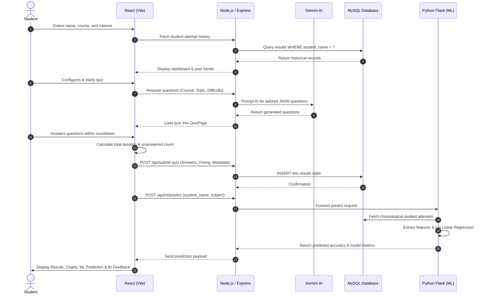

# Student Performance Analyzer

<p align="center">
  
</p>

<p align="center">
  <strong>An Intelligent Full-Stack Educational Assessment & Predictive Analytics Platform</strong>
</p>

<p align="center">
  
  
  
  
  
  
  
  
  
</p>

---

## 📑 Table of Contents

- [Project Overview](#-project-overview)
- [Project Objectives](#-project-objectives)
- [Key Features](#-key-features)
- [System Architecture](#-system-architecture)
- [Technologies Used](#-technologies-used)
- [Machine Learning Implementation](#-machine-learning-implementation)
  - [Learning Paradigm](#1-learning-paradigm)
  - [Mathematical Formulation](#2-mathematical-formulation)
  - [Feature Engineering & Leakage Prevention](#3-feature-engineering--leakage-prevention)
  - [Evaluation Metrics](#4-evaluation-metrics)
  - [Training & Pipeline Workflow](#5-training--pipeline-workflow)
- [Frontend & Backend Description](#-frontend--backend-description)
- [Database Schema & Migrations](#-database-schema--migrations)
- [Project Workflow](#-project-workflow)
- [Installation & Setup](#-installation--setup)
- [Running the Application](#-running-the-application)
- [Screenshots & UI Showcase](#-screenshots--ui-showcase)
- [Future Scope](#-future-scope)
- [Author & Academic Submission Details](#-author--academic-submission-details)
- [Conclusion](#-conclusion)

---

## 📖 Project Overview

**Student Performance Analyzer** is a multi-tier educational analytics platform that unifies real-time AI quiz generation, comprehensive performance visualization, and **Intelligent Machine Learning (IML)** to evaluate student mastery, identify cognitive knowledge gaps, and predict upcoming quiz performance.

Unlike traditional learning management systems that merely tabulate scores, this system:
1. Generates curriculum-aligned dynamic assessments using Generative AI (Google Gemini API).
2. Measures granular student behavior, including response latency, question completion rates, and topic-specific accuracy.
3. Employs a dedicated **Scikit-learn Linear Regression** machine learning engine to forecast a student's future quiz accuracy strictly based on chronological historical data—guaranteeing **zero data leakage**.
4. Provides real-time visual dashboards powered by **Chart.js**, offering students clear feedback and faculty actionable diagnostic insights.

---

## 🎯 Project Objectives

- **Automated Diagnostic Testing:** Eliminate static question banks by dynamically generating tailored quizzes matching a student's enrolled course, interest area, and target difficulty.
- **Behavioral Metric Collection:** Capture deep behavioral telemetry beyond simple scores, including total elapsed time, average time per question, and unanswered question counts.
- **Predictive Performance Modeling:** Apply supervised machine learning regression to model student learning trajectories and estimate future performance trends.
- **Actionable AI Feedback:** Deliver personalized, LLM-generated recommendations addressing weaknesses in specific subtopics.
- **Academic Integrity & Transparency:** Maintain strict scientific integrity by presenting honest model status reports (transparently identifying data sufficiency states rather than fabricating synthetic metrics).

---

## ✨ Key Features

| Category | Capability | Description |
| :--- | :--- | :--- |
| **Authentication & Onboarding** | Dynamic Student Profiles | Supports role-based registration/login with searchable dropdowns for courses and specialized interest domains. |
| **Dynamic Assessment** | Generative AI Engine | Creates custom multi-choice and numerical questions via Google Gemini API with fallback question banks for offline resilience. |
| **Active Exam Telemetry** | Granular Timer Tracking | Tracks total duration, per-question dwell time, unattempted questions, and triggers auto-submission upon timer expiry. |
| **Visual Analytics** | Multi-Chart Dashboard | Displays Doughnut charts (Score ratio), Bar charts (Topic & Difficulty breakdown), and Trend Lines (Historical performance). |
| **Machine Learning** | Next-Quiz Accuracy Prediction | Scikit-learn Linear Regression model forecasts future quiz scores with feature coefficients and error margins. |
| **Model Transparency** | Live IML Status Badge | Shows exact model metrics (MAE, MSE, RMSE, $R^2$), intercept, feature weights, and honest sample count checks. |
| **Data Persistence** | Dual-Layer Storage | Persists all attempts concurrently to a relational MySQL database and resilient client-side `localStorage`. |
| **Concurrency Runner** | Unified Development Script | Single root command boots React frontend, Express API, and Flask ML service in parallel. |

---

## 🏗️ System Architecture

The application adopts a decoupled **3-Tier Microservices Architecture**:

```
+---------------------------------------------------------------------------------------+
|                                    PRESENTATION TIER                                  |
|                             React 19 + Vite SPA (Port 5173)                           |
|       [StudentForm]  --->  [QuizConfig]  --->  [QuizPage]  --->  [ResultAnalysis]     |
|             |                                                         |               |
+-------------|---------------------------------------------------------|---------------+
              | HTTP / REST (Axios)                                     | HTTP / REST
              v                                                         v
+---------------------------------------------------------------------------------------+
|                                    APPLICATION TIER                                   |
|                             Node.js + Express API (Port 5000)                         |
|     - /api/submit-quiz (Stores attempts, scores, time & unanswered metrics)           |
|     - /api/results/student (Retrieves chronological student attempt history)          |
|     - /api/generate-questions (Google Gemini SDK + Fallback question generators)     |
|     - /api/ml/* (API Gateway proxy forwarding to Python ML microservice)             |
+---------------------------------------------------------------------------------------+
              |                                            |
              | MySQL Connection Pool                      | HTTP REST (JSON)
              v                                            v
+------------------------------+         +----------------------------------------------+
|          DATA TIER           |         |             MACHINE LEARNING TIER            |
|       MySQL Database         | <------+       Python Flask ML Service (Port 5001)     |
|        (Port 3306)           | Direct  |                                              |
|  - students (User Profiles)  | Queries |  - db_connector.py (MySQL Fetcher)           |
|  - results  (Attempt Records)|         |  - preprocessing.py (Feature Construction)   |
|                              |         |  - train.py (Scikit-Learn Regression Pipeline)|
|                              |         |  - app.py (REST Endpoints /predict, /train)  |
+------------------------------+         +----------------------------------------------+
```

---

## 💻 Technologies Used

### Frontend
- **React.js (v19.0)**: Modern declarative component architecture with hooks (`useState`, `useEffect`, `useCallback`, `useRef`).
- **Vite (v6.0)**: Next-generation fast frontend tooling and development server.
- **Chart.js & react-chartjs-2**: High-performance canvas-based data visualizations.
- **Axios**: Promise-based HTTP client for asynchronous API communication.
- **CSS3 / Variables**: Custom responsive design system with fluid typography and glassmorphic styling.

### Backend
- **Node.js (v18+) & Express.js (v4.19)**: Asynchronous RESTful API framework and gateway.
- **Google Generative AI SDK (`@google/generative-ai`)**: Context-aware dynamic question generation via Gemini Pro.
- **MySQL2**: Connection pooling, parameterized queries, and transactional integrity.
- **dotenv & cors**: Environment isolation and cross-origin resource sharing.

### Machine Learning Service
- **Python (v3.10+) & Flask (v3.0)**: Lightweight high-performance microservice framework.
- **Scikit-Learn (v1.6.1)**: Production-grade machine learning algorithms, preprocessing transformers, and pipelines.
- **Pandas (v2.2.3) & NumPy (v1.26+)**: High-performance vectorized numerical computation and structured time-series data wrangling.
- **Joblib (v1.4+)**: Serialization and persistence of trained regression pipelines and metadata.
- **mysql-connector-python**: Native Python database driver for direct schema access.
- **Pytest**: Automated testing suite for ML pipelines, feature validation, and edge cases.

---

## 🤖 Machine Learning Implementation

### 1. Learning Paradigm
- **Task Type**: **Supervised Learning — Regression**
- **Objective**: Predict a continuous numerical value: the student's next quiz score percentage ($y \in [0, 100]$).
- **Algorithm**: **Multivariate Ordinary Least Squares (OLS) Linear Regression** implemented via `sklearn.linear_model.LinearRegression`.

### 2. Mathematical Formulation

The prediction model estimates the dependent target variable $\hat{y}$ (Predicted Next Quiz Accuracy) using a linear combination of input features:

$$\hat{y} = \beta_0 + \beta_1 x_1 + \beta_2 x_2 + \beta_3 x_3 + \beta_4 x_4$$

Where:
- $\beta_0$: Model Intercept (baseline performance when all features are zero).
- $\beta_1, \beta_2, \beta_3, \beta_4$: Learned regression coefficients (feature weights).
- The predicted value is post-processed through a boundary clipping function:

$$\hat{y}_{\text{final}} = \min(100.0, \max(0.0, \hat{y}))$$

### 3. Feature Engineering & Leakage Prevention

To uphold strict scientific integrity, **data leakage prevention** is enforced at the architectural level. When constructing training pairs for attempt index $k$, only data from attempts $1, 2, \dots, k-1$ is utilized.

| Feature Name | Type | Unit | Description |
| :--- | :--- | :--- | :--- |
| `prev_accuracy` | Float | Percentage (%) | The student's accuracy achieved on the immediate preceding attempt ($k-1$). |
| `attempt_count` | Integer | Count | Total cumulative quizzes completed by the student prior to the current quiz. |
| `prev_avg_time_per_question` | Float | Seconds | Average time spent per question during prior attempts, reflecting processing speed. |
| `prev_total_time_sec` | Float | Seconds | Total time elapsed on the preceding quiz attempt. |
| **`next_quiz_accuracy` (Target)** | Float | Percentage (%) | Actual accuracy achieved on attempt $k$. |

### 4. Evaluation Metrics

The model is evaluated using standard regression diagnostics:

1. **Mean Absolute Error (MAE):** Average magnitude of absolute residuals:
   $$\text{MAE} = \frac{1}{n}\sum_{i=1}^{n} |y_i - \hat{y}_i|$$

2. **Mean Squared Error (MSE):** Penalizes larger prediction anomalies:
   $$\text{MSE} = \frac{1}{n}\sum_{i=1}^{n} (y_i - \hat{y}_i)^2$$

3. **Root Mean Squared Error (RMSE):** Error in original unit scale (%):
   $$\text{RMSE} = \sqrt{\text{MSE}}$$

4. **Coefficient of Determination ($R^2$ Score):** Proportion of variance explained by the model:
   $$R^2 = 1 - \frac{\sum (y_i - \hat{y}_i)^2}{\sum (y_i - \bar{y})^2}$$
   *(Includes safety zero-variance guards to avoid undefined divisions when test sets have identical targets).*

### 5. Training & Pipeline Workflow

```
[ Raw MySQL Records ] 
         │
         ▼
[ clean_quiz_records() ] ─────────► Filter invalid rows, parse timestamps, validate ranges
         │
         ▼
[ build_historical_training_dataset() ] ──► Chronological grouping by student; pairs (k-1) -> k
         │
         ▼
[ Sufficiency Gate ] ─────────────► Checks: Total pairs ≥ MIN_TRAINING_PAIRS (10)
         │
    ┌────┴────────────────────────┐
    │ Meets threshold             │ Below threshold
    ▼                             ▼
[ GroupShuffleSplit ]          [ Return model_status: "insufficient_data" ]
(Train / Test Split)           (Zero dummy data; honest prompt for more attempts)
    │
    ▼
[ sklearn.pipeline.Pipeline ]
  ├─ SimpleImputer(strategy='median')
  ├─ StandardScaler()
  └─ LinearRegression()
    │
    ▼
[ Metrics Computation ] ──────────► Calculate MAE, MSE, RMSE, R²
    │
    ▼
[ joblib.dump() ] ────────────────► Serialize pipeline to ml_service/models/
```

---

## 🖥️ Frontend & Backend Description

### Frontend Modules (`frontend/src/components/`)
- **`StudentForm.jsx`**: User registration, authentication, course selection (Computer Science, Data Science, Electrical, etc.), and interest specialization.
- **`QuizConfig.jsx`**: Quiz parameters panel supporting question count (5-10), difficulty modes (*Easy*, *Medium*, *Hard*, *Mixed*), and question format (*Multiple Choice* or *Numerical*).
- **`QuizPage.jsx`**: Active test interface featuring countdown timer, dynamic question navigation, unanswered questions accumulator, and question-level duration logging.
- **`ResultAnalysis.jsx`**: Detailed results review screen with:
  - Overall accuracy summary and performance tier badges.
  - Interactive Chart.js graphs for topic and difficulty analysis.
  - Multi-attempt progress trendline with percentage improvement indicators (`↑` / `↓`).
  - **Machine Learning Next-Quiz Prediction Card**: Renders the forecasted score, feature attribution metrics, model coefficients, and training diagnostics.
  - AI-generated personalized study feedback based on test weaknesses.

### Backend Infrastructure (`backend/`)
- **`server.js`**: Core Express server containing route handlers for student profiles, quiz evaluation, question generation, and proxy bridges to the Python ML service.
- **`db.js`**: Central MySQL pool maintaining robust connections with error handling.
- **`update_db.js`**: Safe, idempotent database migration script that dynamically checks and applies necessary column additions to the `results` table without dropping existing records.

---

## 🗄️ Database Schema & Migrations

The project operates on a relational MySQL schema (`student_db`):

### 1. `students` Table
```sql
CREATE TABLE IF NOT EXISTS students (
  id INT AUTO_INCREMENT PRIMARY KEY,
  name VARCHAR(100) NOT NULL,
  course VARCHAR(100) NOT NULL,
  interest_field VARCHAR(100) NOT NULL,
  created_at TIMESTAMP DEFAULT CURRENT_TIMESTAMP
);
```

### 2. `results` Table
```sql
CREATE TABLE IF NOT EXISTS results (
  id INT AUTO_INCREMENT PRIMARY KEY,
  student_name VARCHAR(100) NOT NULL,
  course VARCHAR(100) NOT NULL,
  interest_field VARCHAR(100) NOT NULL,
  score INT NOT NULL,
  total_questions INT NOT NULL,
  percentage DECIMAL(5, 2) NOT NULL,
  attempt_id VARCHAR(100) NOT NULL,
  created_at TIMESTAMP DEFAULT CURRENT_TIMESTAMP,
  
  -- ML Enhanced Fields (Added via update_db.js)
  time_taken_sec INT DEFAULT 0,
  quiz_difficulty VARCHAR(50) DEFAULT 'Mixed',
  question_type VARCHAR(50) DEFAULT 'Multiple Choice',
  subject VARCHAR(100) DEFAULT 'General',
  unanswered_count INT DEFAULT 0
);
```

---

## 🔄 Project Workflow



---

## 📦 Installation & Setup

### Prerequisites
- **Node.js** (v18.x or later)
- **Python** (v3.10.x - v3.13.x)
- **MySQL Server** (v8.0 or later)
- **Git**

---

### Step 1: Clone the Repository
```bash
git clone https://github.com/diparani925-creator/Student-Performance-Analyzer.git
cd Student-Performance-Analyzer
```

---

### Step 2: Configure Environment Variables

1. **Backend Environment**:
   Create `backend/.env` based on `backend/.env.example`:
   ```env
   PORT=5000
   DB_HOST=localhost
   DB_USER=root
   DB_PASSWORD=your_mysql_password
   DB_NAME=student_db
   GEMINI_API_KEY=your_gemini_api_key
   ML_SERVICE_URL=http://localhost:5001
   ```

2. **Machine Learning Service Environment**:
   Create `ml_service/.env` based on `ml_service/.env.example`:
   ```env
   DB_HOST=localhost
   DB_USER=root
   DB_PASSWORD=your_mysql_password
   DB_NAME=student_db
   ML_SERVICE_PORT=5001
   MIN_TRAINING_PAIRS=10
   ```

---

### Step 3: Install Dependencies

Run the following commands from the project root (`STUDENT PERFORMANCE ANALYZER`):

#### 1. Root Workspace Utilities & Node Services
```bash
# Install root runner (concurrently)
npm install

# Install backend dependencies (Express, Gemini AI SDK, MySQL2, etc.)
npm install --prefix backend

# Install frontend dependencies (React 19, Vite, Chart.js, etc.)
npm install --prefix frontend
```

#### 2. Machine Learning Python Virtual Environment (Windows)
Set up the Python virtual environment and install the required machine learning packages:
```powershell
# Create Python virtual environment inside ml_service
python -m venv ml_service\.venv

# Install pinned ML dependencies (Scikit-Learn, Pandas, Flask, etc.)
.\ml_service\.venv\Scripts\python.exe -m pip install -r ml_service\requirements.txt
```

*(On macOS/Linux, use `python3 -m venv ml_service/.venv && ./ml_service/.venv/bin/pip install -r ml_service/requirements.txt`)*

---

### Step 4: Database Initialization & Migrations

Ensure your MySQL server is running and the database `student_db` exists:
```sql
CREATE DATABASE IF NOT EXISTS student_db;
```

Execute the database initialization and migration scripts:
```bash
cd backend
node init_db.js
node update_db.js
cd ..
```

---

## 🚀 Running the Application

### Option A: Single Command Concurrent Runner (Recommended)
You can launch the **Backend API (Port 5000)**, **Frontend Client (Port 5173)**, and **Python ML Service (Port 5001)** simultaneously from the project root:

```bash
npm run dev
```

*The terminal displays color-coded, labeled outputs for easy live monitoring:*
- `[BACKEND]` 🚀 Server running on `http://localhost:5000` & connected to MySQL.
- `[FRONTEND]` ⚡ Vite ready on `http://localhost:5173/`.
- `[ML]` 🤖 Flask ML service active on `http://127.0.0.1:5001`.

### Option B: Running Services Individually

If you prefer running each service in a separate terminal:

1. **Start the Python ML Microservice** (Terminal 1):
   ```powershell
   npm run start:ml
   # Alternatively: .\ml_service\.venv\Scripts\python.exe ml_service\app.py
   ```

2. **Start the Node.js Express API** (Terminal 2):
   ```powershell
   npm run start:backend
   # Alternatively: cd backend && npm start
   ```

3. **Start the React Frontend** (Terminal 3):
   ```powershell
   npm run start:frontend
   # Alternatively: cd frontend && npm run dev
   ```

---

## 📸 Screenshots & UI Showcase

<table align="center">
  <tr>
    <td align="center" width="50%">
      <strong>1. Student Registration & Profile Selection</strong><br/>
      
      <em>Student details, target courses, and interest specializations.</em>
    </td>
    <td align="center" width="50%">
      <strong>2. AI Quiz Generator & Config</strong><br/>
      
      <em>Customizing question count, difficulty level, and format.</em>
    </td>
  </tr>
  <tr>
    <td align="center" width="50%">
      <strong>3. Real-Time Interactive Quiz Page</strong><br/>
      
      <em>Real-time countdown timer, progress bar, and question navigation.</em>
    </td>
    <td align="center" width="50%">
      <strong>4. Comprehensive Analytics & Charts</strong><br/>
      
      <em>Topic-wise breakdown, difficulty accuracy, and score ratios.</em>
    </td>
  </tr>
  <tr>
    <td colspan="2" align="center">
      <strong>5. Intelligent Machine Learning Next-Quiz Prediction Card</strong><br/>
      
      <br/>
      <em>Displays predicted future accuracy, feature weights, historical context, and evaluation metrics (MAE, RMSE, R²).</em>
    </td>
  </tr>
</table>

---

## 🔮 Future Scope

- **Advanced Non-Linear Models:** Implement Random Forest Regressor and Gradient Boosting (XGBoost) to capture non-linear student learning plateaus.
- **Student Knowledge Tracing (BKT / DKT):** Implement Deep Knowledge Tracing using Recurrent Neural Networks (LSTMs) for fine-grained concept mastery modeling.
- **Adaptive Testing (CAT):** Dynamically adjust question difficulty during the quiz in real time using Item Response Theory (IRT).
- **Automated Study Plan Generator:** Provide algorithmically generated weekly study schedules tailored to individual weak areas.
- **Institutional Faculty Portal:** Administrative dashboard enabling instructors to compare class-wide performance metrics and evaluate cohort learning curves.

---

## 👨‍💻 Author & Academic Submission Details

- **Project Name:** Student Performance Analyzer
- **Developer / Author:** [Dipa Rani](https://github.com/diparani925-creator)
- **GitHub Repository:** [https://github.com/diparani925-creator/Student-Performance-Analyzer](https://github.com/diparani925-creator/Student-Performance-Analyzer)
- **Domain:** Web Development & Applied Machine Learning (IML)
- **Purpose:** Academic Project Submission & Technical Portfolio

---

## 🎯 Conclusion

The **Student Performance Analyzer** bridges the gap between active educational assessment and predictive learning analytics. By pairing an interactive modern React user interface with a robust Node.js backend and a mathematically sound, leakage-free Scikit-learn Linear Regression microservice, the system provides both retrospective diagnostic insights and forward-looking performance predictions. It exemplifies professional software engineering standards, modular architecture, and applied machine learning principles.
